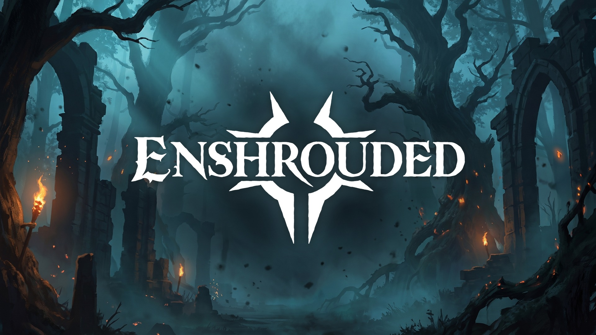

# Enshrouded Shared XP



A server-side mod for Enshrouded dedicated servers. When one player earns non-combat XP, every
other player who is online gets the same amount, wherever they are in the world.

Shared sources: exploration, lore (books, notes), quests, mining and completed item sets.
Combat XP is left to the game by default (it already shares it with players near the kill).
With `ShareCombatXp=1` players far from a kill get the same XP as the players at the kill.

Players need nothing. Only the server gets the mod.

When a player joins, the server chat shows `Shared XP 1.1.2 is active: ...`, so everybody can
see in game that the mod is running. After a game update the mod does not support yet, the
line says `Shared XP 1.1.2 is NOT active: the server was updated ...` instead
(`AnnounceInChat=0` turns the line off).

## Compatibility

| | |
|---|---|
| Game | Enshrouded 1.0 dedicated server, Steam builds **25988414** and **26083076** (October 2026) |
| Windows server | tested |
| Linux server under Wine (Docker image `mornedhels/enshrouded-server:1.7.2-wine`) | tested |
| Proton-based images | should work with the same override, not tested |

The mod checks the server build on every start. On any other build it does nothing, writes
`unknown server build` into `xpshare.log` and the server runs as usual. After a game update
the mod stays inactive until a new version is out.

## Install

The mod is two files next to `enshrouded_server.exe`: `powrprof.dll` and `xpshare.ini`. The
server loads `powrprof.dll` at start; the mod forwards every call to the real Windows
`powrprof.dll`, so nothing else changes.

### Windows dedicated server

1. Stop the server.
2. Copy `powrprof.dll` and `xpshare.ini` into the folder with `enshrouded_server.exe`.
3. Start the server.

### Linux / Docker (Wine)

1. Stop the container.
2. Copy `powrprof.dll` and `xpshare.ini` into the server folder (the one with
   `enshrouded_server.exe`, often a mounted volume).
3. Add the environment variable `WINEDLLOVERRIDES=powrprof=n,b` to the container. Without it,
   Wine uses its built-in `powrprof.dll` and ignores the mod.
4. Start the container.

Example for Docker Compose:

```yaml
services:
  enshrouded:
    image: mornedhels/enshrouded-server:1.7.2-wine
    environment:
      - WINEDLLOVERRIDES=powrprof=n,b
```

### Rented servers

You need file access to the server folder. On Linux hosts you also need a way to set
`WINEDLLOVERRIDES`; ask your host if the panel has no field for environment variables.

## Check that it works

In game: right after "Player <name> joined." the chat shows
`Shared XP 1.1.2 is active: non-combat XP is shared with everyone online.` After a game update
this version does not support, it shows `Shared XP 1.1.2 is NOT active: the server was updated
and this version does not support it yet. ...`; then look for a new version. No line at all
means the mod is not loaded (check the install) or text chat is off on the server.

The mod writes `xpshare.log` next to the server exe. After a start it should show:

```
xpshare 1.1.2 starting: Enabled=1 Multiplier=1.00 DoubleQuestXp=0 ShareCombatXp=0 AnnounceInChat=1 real powrprof loaded
hooked commit_read at ...
hooked mining      at ...
hooked knowledge   at ...
hooked add_helper  at ...
active on server build 26083076: non-combat XP is shared with every online player
hooked join_line   at ... (chat line when a player joins: "Shared XP 1.1.2 is active: ...")
```

With `ShareCombatXp=1` there is one more line, `hooked combat`, and the last line says
`active on server build ...: all XP is shared with every online player`. Each chat line is
logged as `announce: chat line after the join of player handle ...`.

To see every share, set `LogEveryShare=1` and restart. A mined ore then shows as:

```
GAIN   entity 1 +10 XP (Mining, mining)
SHARE  entity 2 +10 XP (pending 0 -> 10)
```

A quest finished together (with `DoubleQuestXp=0`) shows as
`JOINT  entity 2 skips 5 quest XP it earned itself`.

Shared XP does not show the "+XP" popup in game (the game only shows it to the player who
earned it). The receiver's XP number and level still go up.

## Settings (`xpshare.ini`)

The mod creates the file with these defaults if it is missing. Changes need a server restart.

| Key | Default | Meaning |
|---|---|---|
| `Enabled` | `1` | `0` turns the mod off; the server runs unmodded. |
| `Multiplier` | `1.0` | Shared XP = the other player's gain × this value. `0.5` = half, `0` = no sharing. Range 0 to 10. |
| `DoubleQuestXp` | `0` | Quests finished together. `0`: each player gets the quest XP once (from the game); shared quest XP arrives about 5 seconds after the quest. `1`: each player also gets the other players' share, so double quest XP. |
| `Log` | `1` | Write `xpshare.log`. |
| `LogEveryShare` | `0` | `1` = one line per gain and per share. Useful to check it works; the log grows fast. |
| `ShareCombatXp` | `0` | Combat XP. `0`: left to the game, only players near a kill get XP. `1`: every player who was not near the kill also gets XP for it, the same amount the players at the kill got (the largest, if they got different amounts), once per kill. Players at the kill get nothing extra. Arrives about 1 second after the kill. |
| `AnnounceInChat` | `1` | `1`: when a player joins, the chat shows one line that the mod is active, or that it is NOT active because the server build is not supported yet (everyone online sees it). Needs text chat enabled on the server. `0`: no line. |
| `TestUnknownBuild` | `0` | Test only: `1` makes the mod behave as on a server build it does not support (no sharing, the chat line says NOT active). Not in the default file. |
| `TestSelfShare` | `0` | Solo test: `1` credits your own non-combat XP to you once more, so one player can check the mod. Not for normal play. |
| `LogAllXp` | `0` | Diagnostics: logs every XP amount any player receives. |

## Good to know

- **Online only.** A player who is offline gets nothing for what others earned meanwhile.
- **Quests done together.** The game gives every player who finishes a quest its XP. With
  `DoubleQuestXp=0` (default) the mod does not add the other players' share on top; with `1`
  it does, so double quest XP. The mod treats two quest gains of the same amount within 10
  seconds as the same quest.
- **Combat XP** stays as the game handles it unless `ShareCombatXp=1`. Then a player who is
  mining while a friend fights elsewhere levels up with the friend instead of falling behind.
  The game gives less XP per player when several fight together, and it scales XP with the
  player's level; a far player gets the amount the players at the kill got.
- **No network traffic.** The mod only changes how much XP the server gives; it opens no
  ports and contacts nothing.
- **Antivirus.** Proxy DLLs like this one are sometimes flagged by heuristics. The full
  source is in this repository; you can build the DLL yourself (see below).

## Uninstall

Stop the server, delete `powrprof.dll` (and `xpshare.ini`, `xpshare.log`), start the server.
On Docker you can also remove `WINEDLLOVERRIDES`. XP that was already shared stays.

## Build from source

Needs Windows, Visual Studio 2022 Build Tools (C++ and MASM), CMake 3.28+ and Ninja.

```
build.cmd
```

`build.cmd` builds `build\powrprof.dll`, runs the unit tests and builds
`build\xpshare_selftest.exe`. The selftest checks a server exe on disk without starting it:

```
build\xpshare_selftest.exe "C:\path\to\enshrouded_server.exe"
```

`OK: all hook sites found` means the mod would hook that build. `package.cmd` builds and
writes the release zip into `dist\`.

How the hooks work and what to do after a game update: [docs/HOW-IT-WORKS.md](docs/HOW-IT-WORKS.md).

## Credits

- The idea of distance-free XP sharing comes from the earlier XP share mod on Nexus Mods
  (mod #110). This mod is a new implementation for Enshrouded 1.0.
- Hooks via [SafetyHook](https://github.com/cursey/safetyhook) with
  [Zydis](https://github.com/zyantific/zydis), see [THIRD_PARTY_NOTICES.md](THIRD_PARTY_NOTICES.md).

## License

MIT, see [LICENSE](LICENSE).
